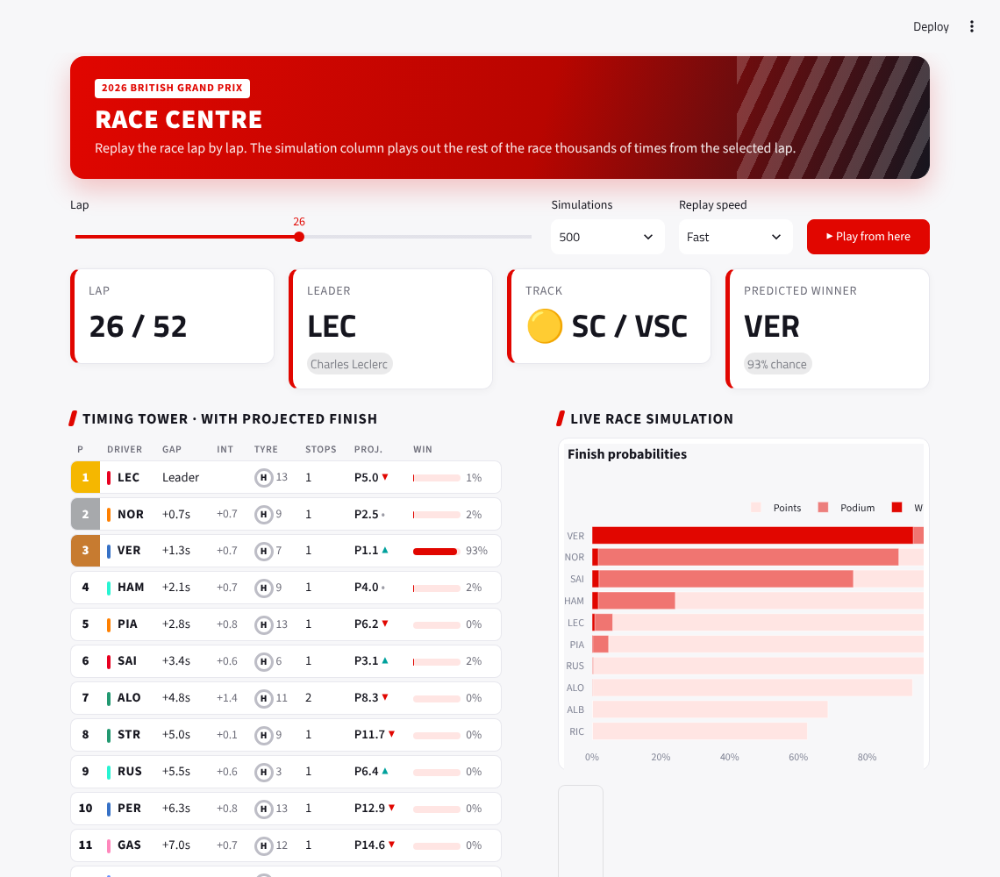
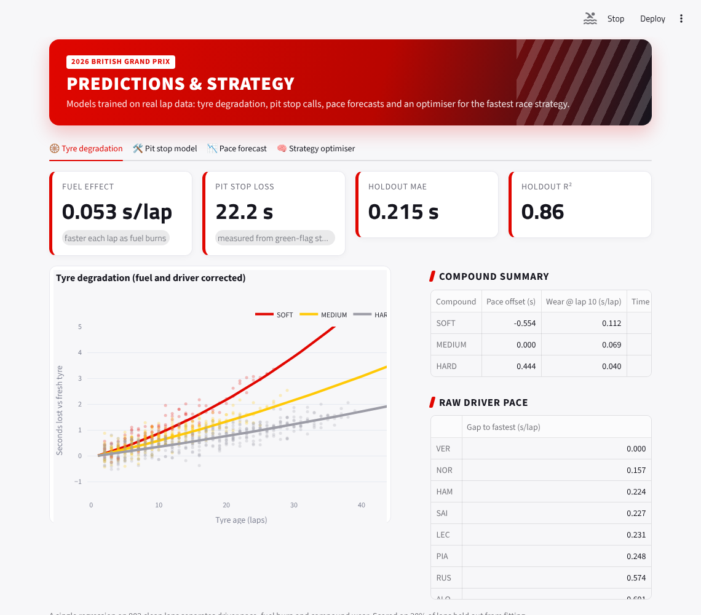
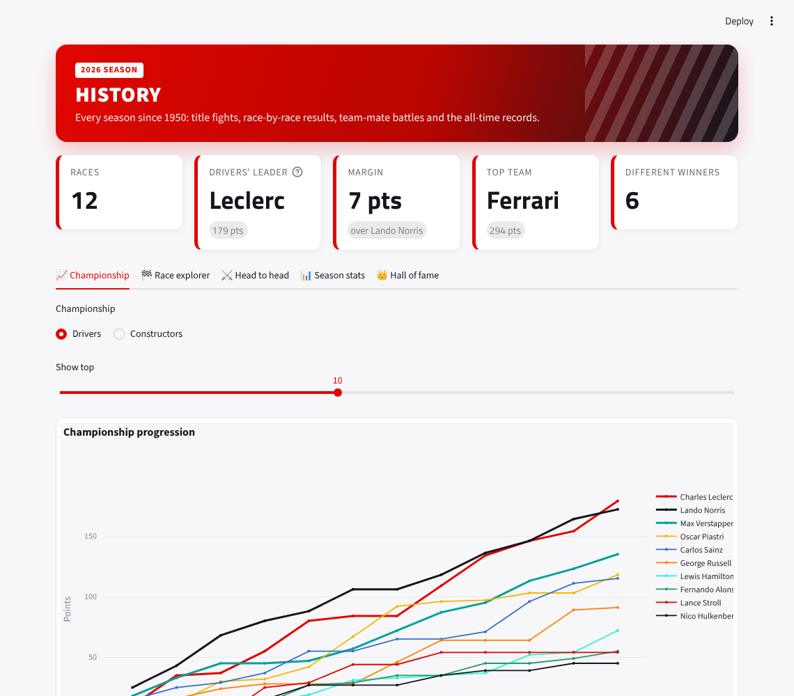

# 🏎️ F1 Race Intelligence

[](https://github.com/gouravmurmu/f1dashboard/actions/workflows/ci.yml)


A Formula 1 analytics app built on real timing data: replay any race lap by lap while a Monte Carlo
simulator predicts the finish, explore machine-learning tyre and pit stop models, compare telemetry,
and dig through every season since 1950.



## What's inside

### 🏁 Race Centre: replay + live race simulation
- Scrub or **play** through a race lap by lap with a timing tower (gaps, intervals, tyres, stops).
- A **live simulation column** next to the tower shows each driver's projected finish and win chance,
  recalculated from the selected lap by simulating the rest of the race hundreds of times.
- Position chart, gap-to-leader chart with safety car periods, tyre strategy chart, and a heatmap of
  every driver's predicted finishing position distribution.

### 🔮 Predictions & strategy
| Model | What it does | How it is validated |
| --- | --- | --- |
| **Tyre degradation** | One regression separating driver pace, fuel burn and per-compound wear (linear + quadratic) | MAE and R² on 20% held-out laps |
| **Pit stop model** | Gradient-boosted trees predicting a stop this lap from tyre age, compound, stint, race progress, pace drop-off, safety car and position | Grouped cross-validation (whole drivers held out), compared with a tyre-age-only baseline |
| **Race simulator** | Monte Carlo race engine using both models, the two-compound rule, random safety cars and measured lap-time noise | Probabilities are consistent by construction; tested against late-race leaders |
| **Pace forecast** | Next-N-lap lap time forecast with a 90% band | Compared with what actually happened |
| **Strategy optimiser** | Evaluates every one- and two-stop plan with the fitted wear curves and measured pit loss | Shown next to the strategies teams actually ran |

The pit stop model can also train on earlier races of the same season for more data.

### 📡 Telemetry
Fastest-lap speed, throttle, brake and gear traces for two drivers, a running time delta, and a
**track dominance map** showing who is faster in each mini-sector.

### 🏆 History (1950 to today)
- Championship progression for drivers and constructors, with standings (wins, podiums, poles, DNFs).
- Race explorer with a grid-vs-finish chart and sprint results.
- Team-mate **head-to-heads** (race, qualifying, points).
- Filterable season results with CSV export, and an all-time **hall of fame** of champions.

| Predictions | History |
| --- | --- |
|  |  |

## Data

- **FastF1** for lap timing, tyres, track status, weather and car telemetry (2018 onwards). Downloads
  are cached on disk in `.fastf1-cache/` (override with `F1_CACHE_DIR`), so a race only loads slowly once.
- **[Jolpica](https://github.com/jolpica/jolpica-f1)** (the maintained Ergast replacement) for results
  back to 1950.
- **Demo data**: a built-in race generator (fuel, tyre wear, pit stops, safety cars, retirements). Pick
  *Demo data* in the sidebar to work offline. If live data can't be reached, the app falls back to it
  automatically and says so.

## Run it

```bash
python -m venv .venv && source .venv/bin/activate
pip install -r requirements.txt
streamlit run app.py
```

With Docker (the timing cache is kept in a volume):

```bash
docker compose up --build
```

Then open http://localhost:8501.

## Development

```bash
pip install -r requirements-dev.txt
ruff check .
pytest -q
```

The tests cover data normalisation, race state, history tables, every model (including a check that
the pit model has no target leakage), and render every page end to end on demo data.

## Project layout

```
app.py                 home page
pages/                 Race Centre, Predictions, Telemetry, History
backend/               FastF1 + Jolpica loaders, demo data generator, shared schema
models/                tyre model, pit stop model, race simulator, strategy optimiser
components/            theme, charts, timing tower, shared sidebar and caching
tests/                 pytest suite
```

*Unofficial project, not associated with Formula 1 companies. F1 is a trademark of Formula One Licensing B.V.*
